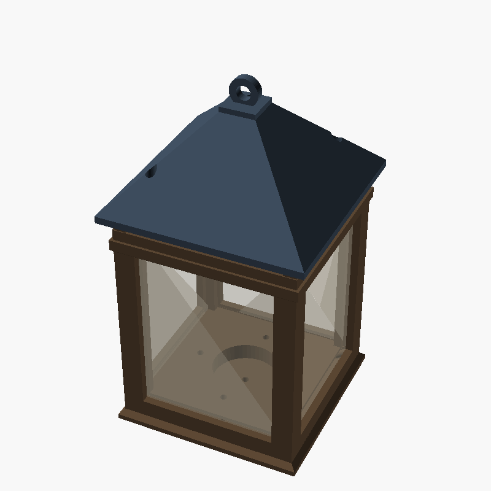

# Liberty Lamp Lantern

Printable frame for 13 Craftsman-style hanging lanterns, one per original colony. See the [design spec](docs/spec.md).



## Build

Prereqs: [OpenSCAD](https://openscad.org) (`brew install openscad`) and Node 20+. There are no npm dependencies.

```bash
make            # STLs → build/stl, validate, previews → build/png
make test       # unit tests for the STL checker
make clean
make BED=220    # validate against a smaller print bed
```

`make` fails if any part is empty, non-manifold, or larger than the bed. It also fails if parameters conflict: for example, a candle cup wider than the interior.

To try a different parameter without editing the file:

```bash
openscad -D 'part="body"' -D panel_thickness=2 -o body.stl src/lantern.scad
```

Open `src/lantern.scad` in the OpenSCAD app for a live preview. Set `part` to `"assembly"` to see the whole lantern with stand-in panels.

## Parts (per lantern; print 13 of each)

| Part | Size (mm) | Orientation |
|------|-----------|-------------|
| `body.stl` | 108 × 108 × 134 | upright, base on bed |
| `roof.stl` | 114 × 114 × 68 | peak up, open side on bed |

Assembled height is about 202 mm (8"). Neither part needs supports.

## Key parameters

All of these live at the top of [`src/lantern.scad`](src/lantern.scad).

| Parameter | Default | Notes |
|-----------|---------|-------|
| `W` | 102 | body width across the posts |
| `post_w` | 12 | corner post size |
| `panel_h` | 100 | visible panel height |
| `panel_thickness` | 3.0 | set to match the chosen panel material |
| `panel_clearance` | 0.3 | tune after a test print |
| `slot_depth` | 4 | how far panel edges sit into the posts |
| `led_d` / `led_h` | 38 / 10 | candle cup; set once the LED module is chosen |
| `cord_d` | 4.5 | 12V cord channel |
| `standoff_h` | 6 | vent gap under the roof |
| `insert_d` / `insert_depth` | 4.2 / 6 | M3 heat-set insert hole |

The panel size is computed from these and printed during each build:

```
ECHO: "PANEL (w × h × t): 85.4 × 113.7 × 3 mm, qty 4"
```

## Print settings

- PETG or ASA (it hangs outdoors; avoid PLA)
- 0.2 mm layers, 3 walls, 20% gyroid infill

## Hardware (per lantern)

- 2× M3 heat-set inserts, installed into the two bosses in the top corners of the body
- 2× M3×10 socket-head screws, driven down through the wells in the roof
- 4× panels, 85.4 × 113.7 mm (panel material is still TBD)

## Assembly

1. Thread the 12V cord through the hole beside the hanging eye. Run it across the inside of the roof, down the hollow +X/+Y corner post, and out through the base tunnel into the candle cup.
2. Drop the 4 panels in through the slits in the top rail.
3. Set the roof on the standoffs and screw it down. The lantern hangs from the roof eye, so these screws carry its weight.

The roof screw wells are open on top; a dab of sealant or a printed plug keeps rain out.

## Layout

```
src/lantern.scad          parametric model (body, roof, assembly)
scripts/check-stl.mjs     STL validator (empty / non-manifold / bed size)
docs/spec.md              project spec
docs/superpowers/         design + implementation plan
build/                    generated (gitignored)
```
